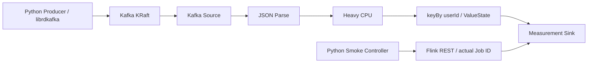

# 아키텍처와 기술 결정

## 구성

각 Operator는 Name/UID/P가 독립적이다. Smoke는 Source=2, Parse=3, Heavy=4, Aggregation=2, Sink=3으로 Graph 설정을 실제 조회해 확인한다. maxParallelism=128, 진단 기본 Chaining off. noWatermarks/무한 KafkaSource이며 테스트 종료는 Drain 후 Cancel이다.

## 고정 버전과 근거

| 구성 | 선택 | 검증 방법 |
|---|---|---|
| Flink | 2.2.1-scala_2.12-java17 | 공식 릴리스, 공식 이미지 pull, 실제 E2E |
| Kafka Connector | 5.0.0-2.2 | 공식 Maven artifact, Java17 build/E2E |
| Kafka broker | apache/kafka:4.2.1 | Apache 릴리스, 이미지 pull, KRaft metadata 요청 |
| Maven/JDK | maven:3.9.11-eclipse-temurin-17 | 이미지 pull, 컨테이너 verify |
| Producer | python:3.12.12-slim-bookworm / confluent-kafka 2.12.2 | wheel 설치와 실제 ACK |
| JSON | Jackson Databind 2.18.3 | Maven build; private relocation |
| JUnit | 5.11.4 | 핵심 계산/상태/파싱 Unit |

호스트 Maven 설치를 요구하지 않으며 Java21/Python3.14 호스트와 기준 런타임을 구분한다. Python Producer는 librdkafka 기반 비동기 ACK와 명시적 Partition 제어를 사용한다. 아직 고부하 Capacity가 검증된 것은 아니다. 직접 의존성·플러그인은 pom과 requirements에 고정한다. 전이 의존성은 Maven dependency:tree로 재현한다. 이미지 태그는 구체 버전이며 pull한 Digest는 validation에 보존한다. 완전한 바이너리 동일성이 필요하면 보존된 Digest로 pin해야 한다.

공식 근거: [Flink 2.2.1 발표](https://flink.apache.org/2026/05/15/apache-flink-2.2.1-release-announcement/), [Kafka Connector artifact](https://central.sonatype.com/artifact/org.apache.flink/flink-connector-kafka/5.0.0-2.2), [Flink 이미지](https://hub.docker.com/_/flink/), [Kafka 다운로드](https://kafka.apache.org/community/downloads/), [KafkaSource 문서](https://nightlies.apache.org/flink/flink-docs-release-2.2/docs/connectors/datastream/kafka/), [메트릭](https://nightlies.apache.org/flink/flink-docs-release-2.2/docs/ops/metrics/). 공식 자료의 존재는 실제 조합 테스트를 대체하지 않는다.

## 자원 예산

기본 한 개 TM: 2 CPU / 컨테이너 2560MiB / Flink process 2048MiB / 16 Slots. JM: 0.5 CPU / 컨테이너1536MiB / process1024MiB. Kafka: 1 CPU / 1536MiB / heap512MiB. Producer: 0.5 CPU / 512MiB. 네 서비스 quota 합은 4 CPU이며 동일 Host에서 경합한다. Builder는 성능 Run 중 실행하지 않는다.

fixed-resource 비교에서는 이 예산과 TM 수를 유지한다. P=16이어도 실제 TM quota는 2 CPU이다. Slot은 스케줄링 단위이며 CPU 예약이 아니다. 기본 Slot Sharing에서 Operator P 합으로 Slot 수를 계산하지 않는다. Phase 2는 REST TaskManager·Graph·Subtask 배치, cluster occupied Slots와 cgroup CPU/Throttle를 시계열로 수집한다. 다른 Job이 있으면 실행하지 않아 cluster Slots를 해당 Run과 연관시킨다. 추가 TM은 CPU 총예산도 늘리므로 기존 fixed-resource 결과와 직접 혼합하지 않는다.

실제 Phase1 로그에서 기본 Flink `taskmanager.cpu.cores` 논리 resource profile은16.0으로 계산됐지만 Docker quota는2 CPU였다. Flink ResourceProfile은 물리 CPU 계측이 아니므로 두 값을 구별한다. Phase2 환경 보고서에서 논리 선언값/실제 cgroup 한도를 분리하고 경고한다.

## State와 Checkpoint

기본 HashMap, 옵션 RocksDB. ValueState<Long>로 Key별 Count를 저장하고 1:1 출력한다. Checkpoint는 filesystem storage, 공용 named volume `/checkpoints`, Run별 `file:///checkpoints/RUN_ID`. Phase 1에서는 local Compose 환경용이며 Production 내구성/HA를 제공하지 않는다. 새 Job·새 Group·새 Topic·새 경로를 사용하고 restore하지 않는다. 실패/종료 이후 경로를 재사용하지 않는다. Checkpoint 자료는 보존하며 삭제는 별도 관리 작업이다.

기본 restart-strategy none: 재처리 오염을 숨기지 않고 실패를 드러낸다. Flink 내부 EXACTLY_ONCE Checkpoint 모드도 비트랜잭션 Measurement Counter의 Exactly-once 보장은 아니다. 재시작 검증은 후속 Phase의 계약이다. 기본 Consumer Offset은 earliest; 새로운 Topic을 만들므로 과거 실행의 영향을 받지 않는다.

## 계산과 관측

Heavy: Payload/User 기반 FNV seed 후 정수 mixing. loop에서 새 객체/배열을 생성하지 않고 출력 필드에 계산값을 남겨 Sink Checksum에 사용한다. Keyed CPU는 Heavy 결과와 최신 User Count를 입력으로 사용한다. System.nanoTime으로 결정적 Sequence 샘플의 연산 구간을 계측한다. JVM 최적화·JIT·GC 영향을 받을 수 있다.

Sink는 completedRecords/measurementCompletedRecords/warmupCompletedRecords, sequenceSum/resultChecksum, duplicateRecords와 log2 Latency Bucket·SampleCount/Min/Max를 등록한다. CPU ns Histogram도 동일 방식이다. Bucket은 병합 가능하지만 coarse한 상한 근사치다. Phase 2는 Bucket을 Subtask 간 합산해 p50/p95/p99와 시간 구간 Histogram 차분을 계산한다. 새 measurementWindowCompletedRecords와 measurementWindowCohortCompletedRecords는 이벤트의 고정 구간 시각과 Sink wall clock으로 계수한다. Warm-up 생성분이 Measurement에 도착한 수와 Measurement 코호트의 Drain 완료 수를 분리한다.

Smoke에만 제한적 Bitset Audit(최대10,000 ID)을 켜고 각 Sink의 Word를 REST에서 읽어 합집합/교집합·전체 ID 범위를 검증한다. 정상 대규모 측정은 `--verification-records 0`으로 비용을 제거한다. 대규모 Exactly-once 증명으로 일반화하지 않는다. 검증 Counter는 Checkpoint State가 아니므로 Restart가 발생한 Run에 적용할 수 없다.

## 준비·제출·정리

Kafka health는 실제 topics metadata 요청. JM은 `/overview` HTTP200. TM health는 RPC TCP 생존일 뿐이며 Controller에서 등록된 TM와 free slot, 모든 Vertex RUNNING, 실제 입력 진행을 확인한다. Kafka internal 주소 kafka:29092, host localhost:9092를 분리한다. Plaintext 단일 broker는 로컬 실험 전용이다.

제출 CLI 출력에서 실제 JobID를 추출하고 REST로 RUNNING/Graph/메트릭을 조회한다. 실패 시 예외를 저장한다. finally에서 해당 Run의 Producer 컨테이너·Job만 정리하고 Topic 삭제를 요청한다. 서비스는 재실행 편의를 위해 유지하며 `make down`으로 종료한다. Run 결과는 새 UUID 경로/파일 exclusive 생성으로 덮어쓰지 않는다.

## Phase 2 계측 시스템

REST Job/Vertex/Subtask metrics 목록을 매번 조회한다. 늦게 등록되는 메트릭을 재발견하며 긴 요청을 분할한다. 없는 지표를 고정 이름으로 0 처리하지 않는다. Counter와 Task busy/idle/backpressure는 다른 범위이며 Chaining에 영향을 받는다. Phase 2 Controller는 Chaining off로 제한한다. KafkaSource pendingRecords는 실제 등록값을 저장한다. 별도 KafkaRecordDeserializationSchema는 실제 읽은 ConsumerRecord offset+1을 Partition별 Gauge로 등록한다. 이 값은 committed offset나 Kafka consumer prefetch 위치가 아니다. Admin API의 LEO/Commit와 별도 의미로 저장한다.

Clock은 host wall-clock 전후로 container date를 감싸 가능한 offset 구간/왕복 오차를 저장한다. 이는 Clock 동기화를 보장하지 않는다. Phase 2는 Producer도 직접 probe하고 허용 오차를 판정한다. cgroup v2 CPU quota/실사용/Throttle/Memory/OOM과 TM JVM GC/Process CPU 원시 메트릭을 보존한다. 정확한 Subtask CPU 귀속과 State-size Gauge는 Unsupported로 남기며 Checkpoint state_size는 별도로 기록한다. Prometheus reporter/Grafana는 이번 범위에서 구성하지 않고 REST를 기본 수집 경로로 사용한다.

`session.py`는 Monotonic Clock으로 예정 시점을 계산하며 Flink 처리 속도를 기다리지 않는다. Producer Queue 초과는 발행 실패, 구간 종료 후 예정 시점은 expired로 남겨 처리율 미달을 숨기지 않는다. JSONL 통계 및 Kafka Admin observer는 Producer의 0.5 CPU 예산을 공유한다. 별도 Preflight Topic에서 동일 부하가 유효한지 먼저 확인한다. Admin 추가 조회/계측도 오버헤드이므로 실제 cadence와 resource pressure를 기록한다.

Flink REST metric fetch interval은 1초다. Source/Sink는 Subtask별 별도 객체의 timestamp Gauge를 등록한다. REST 캐시의 시각을 확인하고 이후 새 Kafka Admin snapshot과 결합한다. 시각 차이 3초 초과, 미등록/충돌/음수 차이는 null로 남긴다. Drain에는 Producer 종료 후 같은 이미지의 일회성 observer로 LEO/Commit를 갱신한다. timestamp Gauge는 같은 fetch frame의 근사 시각이며 원자적 분산 snapshot을 보장하지 않는다.

Run은 새 Topic/Group/Job/Checkpoint 경로/UUID 결과 폴더를 사용한다. finally에서 해당 Producer/Probe/Observer만 정리하고 실제 Job terminal 상태와 Topic 삭제를 확인한다. 판정 및 오류 원문은 보존한다. 자세한 정의와 기준은 [measurement-methodology](measurement-methodology.md)를 따른다.

## Phase 3 실행·분석

Phase 3의 이력과 기본 구조는 유지하며 Phase 4의 확장은 아래 절에 기록한다.

`experiment_engine.py`는 기존 단일 Run을 순차 호출하고 실제 experiment_1/experiment_2 ID와 조건/역할/반복을 기록한다. 새 Session에 실행 전 Config와 예산 계획을 고정하고, Rate 시도 및 개별 Run을 append-only로 남긴다. 실험2 prediction.json은 독립 검증 전에 저장한다. 각 Run의 JAR/Producer Artifact SHA256과 실제 이미지/자원·Runtime·Workload fingerprint로 비교 조건을 확인한다. Hash는 측정된 성능을 검증하는 값이 아니라 바이너리/설정 동일성의 근거다.

`capacity_analysis.py`는 실제 Operator/Subtask Counter 차분, Busy/Idle/Backpressure, 부하 CV와 cgroup 제한을 확인한다. 조건이 부족하면 NOT_ESTIMATED로 남기며 Job/P fallback은 없다. Full Calibration과 Validation은 서로 다른 Run ID·Topic·Group·State·Seed 정책을 사용한다. 산술은 별도 순수 모듈로 검증한다.

분석은 부하 Run 이후 별도 `analyzer` 컨테이너에서 수행한다. Python3.12.12 기반 NumPy2.2.6/Pandas2.2.3/Matplotlib3.10.3과 전이 패키지를 analysis/requirements.txt에 고정한다. Agg backend로 X 서버 없이 PNG를 만들고 한국어 설명은 Markdown에 둔다. 차트 영문 라벨은 컨테이너에 한글 폰트 의존성을 추가하지 않기 위한 선택이다. 각 분석은 새 디렉터리로 출력한다. 버전 존재는 PyPI 공식 릴리스와 실제 wheel 설치로 확인했다: [Pandas](https://pypi.org/project/pandas/2.2.3/), [Matplotlib](https://pypi.org/project/matplotlib/3.10.3/), [NumPy](https://pypi.org/project/numpy/2.2.6/).

## Phase 4 실행·계측·분석

`phase4_engine.py`는 같은 run_once 실행기를 재사용하되 Operator별 Named Case와 Uniform/Skewed 쌍을 만든다. 사전점검의 CPU0 조건은 별도 role/Run이며 실제 Case의 작업량을 자동 변경하지 않는다. 메타데이터·Raw·두 Run 상태는 그대로 보존하고 input_comparison_validity/Partition pair 판정을 별도로 기록한다. 실험4 쌍은 실제 Graph/Seed가 같아야 하며 분포 차이만 통제 변수로 fingerprint에서 제외한다. 다른 리소스·Artifact·Workload는 혼합하지 않는다.

AggregationMeasurements는 실제 측정 코호트의 Hot/일반 처리, 시간 내 처리와 실제 Hot 처리 이후의 Subtask/Key Group Gauge를 제공한다. Counter는 비트랜잭션이며 final Producer ACK Hot·Sent·Restart·신선도를 대조해 배치 증거를 한정한다. Warm-up/준비 Hot 관측만으로 Measurement 배치를 확정하지 않는다.

SampledCpu는 Java17 ThreadMXBean으로 Heavy/Keyed 본문만 샘플링한다. 기본0에서는 Thread CPU Time을 읽지 않으며 Phase4 기본10으로 명시적으로 켠다. 지원/유효 샘플/잘못된 CPU 읽기를 따로 기록하고 CPU ns/샘플을 전체 Task CPU %로 표시하지 않는다. 새 Counter 및 샘플링의 전체 오버헤드가 이전 Phase와 같다고 가정하지 않는다. out.collect/Network/GC/runtime 비용과 샘플 대표성은 한계로 둔다. 자세한 기준·공식 근거는 [phase4-design](phase4-design.md)을 따른다.

phase4_analysis는 이전 분석 이미지와 표 저장 함수를 재사용해 개별 Case/분포/P/Graph/물리 예산별 통계와 Operator/Subtask Heatmap을 생성한다. 비교 전제 미충족이면 공통 곡선을 보류하고 개별 관측/실패는 표에 보존한다.

## Phase 5: Source 할당과 전체 실험

ObservedKafkaSource는 원래 KafkaSource의 Enumerator/직렬화/Reader 실행·Checkpoint/종료 계약을 위임하며 실제 Reader.addSplits가 수락한 할당에 Gauge를 추가한다. 단일 고정 Topic/Unbounded/Discovery off/Restart0 조건을 명시한다. Reader Count0을 실제 관측하고, 전체 Partition 소유자·신선도·Offset 증거·관측 epoch를 교차 검증한다. 자세한 API 근거와 지원 범위는 [phase5-design](phase5-design.md)에 있다. 일반 동적 Partition/복구 Source로 확장된 Adapter라고 해석하지 않는다.

phase5_engine은 run_once의 동일 격리/Rate/구간/메트릭/정리를 사용해 Source P만 바꾸고 Downstream을 고정한다. 비교 fingerprint는 실제 Downstream Graph·물리 예산·Artifact를 포함한다. Source Capacity 가설과 실제 Assignment 관측을 구별한다.

benchmark_suite는 모든 Phase 실행기를 순차 호출하고 전체 frozen 계획·Hash·실제 Session Manifest를 보존한다. 측정 중 Code/JAR/Producer/Compose 변경 및 정리 오류는 다음 실험을 중단한다. Analyzer는 부하가 끝난 뒤 별도 실행한다. blog_report는 선택한 Mode와 정확한 Session 집합을 통합하며 실험 간 Capacity/통계는 합치지 않는다. 누락/미검증 결과는 Not Executed다. 재현·보존·환경 한계는 [reproducibility](reproducibility.md)를 따른다.
