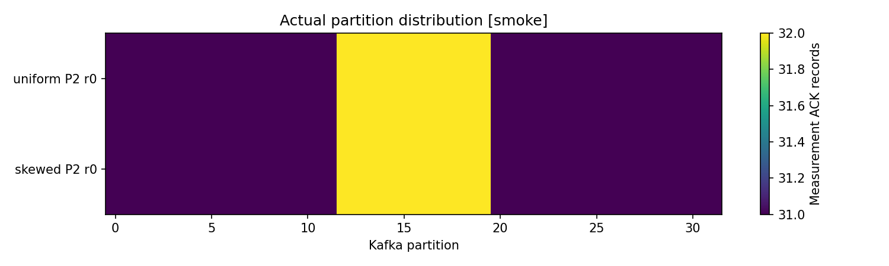
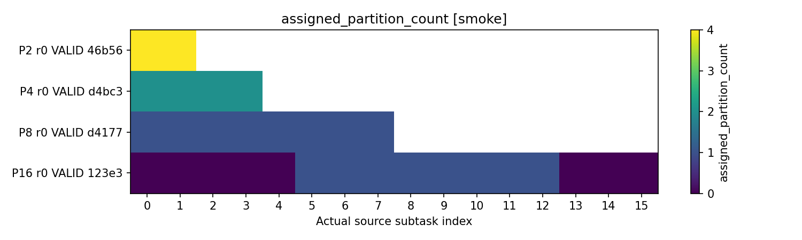

# 「Flink Parallelism은 어떻게 결정해야 할까?」 실험 증거 보고서

작성일: 2026-10-28. 실측 실행일: 2026-10-09(UTC). 이 보고서는 저장된 실행 결과를 추출·검증한 문서이며, 작성 과정에서 새로운 부하 실험을 실행하지 않았다.

## 1. 이 실험으로 답할 수 있는 질문

현재 결과로 **최적 Parallelism의 숫자를 제시할 수는 없다.** 저장된 실험은 짧은 Smoke이며 지속 가능한 최대 처리 용량, 계산한 병렬도의 적절성, 운영 병렬도의 장시간 검증은 **Not Executed**다. 대신 병렬도를 결정할 때 확인해야 할 두 가지 구조적 제약을 실제 데이터로 보여 준다.

| 블로그에 사용할 주장 | 직접 관측한 근거 | 해석의 범위 |
|---|---|---|
| Kafka Partition이 늘어나지 않으면 Source Reader를 늘려도 일부 Reader에는 Partition이 배정되지 않을 수 있다 | Partition 8개·Source P=16에서 실제 Count=0인 Reader 8개 | 이 실행의 할당 구조를 확인했다. 최대 처리량과 최적 Source P는 미측정 |
| `keyBy` 이후 하나의 Hot Key는 P를 늘려도 하나의 Subtask에서 처리될 수 있다 | 보조 P=2·4 비교에서 Hot 이벤트 394건이 각각 Subtask 1·2 한 곳에 남음 | Hot Key 배치와 처리 건수 불균형을 확인했다. 포화 병목·성능 저하는 미입증 |
| 모든 Operator의 P를 함께 올리는 효과는 병목과 물리 자원을 확인한 뒤 판단해야 한다 | TM 2 CPU 고정, Operator P를 다르게 설정한 실행은 성공했으나 의도한 포화 후보는 미관측 | Operator별 설정·계측을 검증했다. 증설 우열과 성능 향상률은 미입증 |

**보고서의 대표 증거는 할당과 처리 분포다.** 낮은 입력률에서 관측한 Sink 처리율을 최대 Capacity로 해석하거나, 작은 처리율 차이를 병렬도 변경의 효과로 해석하지 않는다.

## 2. 원본 선택과 실행 상태

### 2.1 주요 결과와 보조 결과

주요 결과는 기존 [최종 통합 보고서](../results/reports/report_a306f3d0e0c448168054d0a299989136/blog-report.md)의 선택을 고정했다. 향후 실행으로 바뀔 수 있는 “최신 디렉터리”를 다시 선택하지 않았다.

| 실험 | 주요 Session ID | Run 수 | 주요 조건 |
|---|---|---:|---|
| 1. P와 Capacity 탐색 | `session_4de58697a13f4ee1a1a27126ec7c31f7` | 2 | P=1, 탐색/고정 입력 각 1회 |
| 2. Capacity 기반 P 계산 | `session_a44090a622cd4e8ead5a96f45f84ea30` | 2 | P=1, Calibration/독립 Probe |
| 3. Operator별 P | `session_1fa92d1005be4a09912fc32e57ff7f36` | 4 | 저작업량 사전 점검 1회와 실제 Case 3개 |
| 4. Uniform/Skewed | `session_3864ea80df19450ea86ed3716d87280d` | 2 | P=2, 분포별 1회 |
| 5. Partition/Source P | `session_08186d814fb3492ab098a86cba361466` | 4 | Source P=2/4/8/16, Downstream P=8 |

이 14개 Run은 모두 **Execution Validity=VALID, Performance Stability=UNKNOWN**이다. 이는 실행·입력·정합성 검사를 통과했다는 뜻이다. 장시간 안정성 판정을 통과했다는 뜻으로 사용하지 않는다.

P 증가에 따른 Hot Key 배치를 확인하기 위해 이전 [실험 4의 P=2·4 Session](../results/experiment_4/session_8a3381c7f9b04c4b97bb8b26bc0d9069/analysis_fdc0f9324804431a941547ca13871a95/report.md)의 4개 Run을 **보조 결과**로 분리했다. 이들도 VALID + UNKNOWN이다. 주요 결과의 P=2 실행과 반복 통계를 합치지 않는다. Artifact/실행 시점이 다른 Session을 하나의 성능 곡선으로 취급하지 않는다.

모든 행의 전체 Run ID·Job ID·원본 링크는 [원본 색인](experiment-evidence/run-index.md)에 있다. [runs.csv](experiment-evidence/runs.csv)는 18개 Run의 수치와 설정을, [evidence.json](experiment-evidence/evidence.json)은 결측 원인·관측 근거·Artifact SHA256을 보존한다. CSV의 일반 빈 셀은 해당 없음/미수집이며 JSON의 null 및 원본 설명을 함께 확인한다.

### 2.2 실패 이력을 포함한 전체 실행 범위

작성 시점의 `results/experiment_*/session_*/runs/*/summary.json` 전수 확인 결과는 **46개 Run: VALID 41, INVALID 3, ERROR 2, 안정성은 모두 UNKNOWN**이다. 모두 mode=smoke다. 이 집계에는 별도 `smoke/`, `phase2/`, `preflight/` 실행과 Unit Fixture를 포함하지 않는다. 위의 18개는 보고서에 사용한 선택 집합이며 프로젝트 전체 실행 건수가 아니다.

원래 [전체 Suite 결과](../results/suites/suite_4b991cf19ca2404db35cd03616b51716/suite_summary.json)는 14개 중 VALID 11/INVALID 2/ERROR 1로 `COMPLETED_WITH_RUN_FAILURES`였다. 실험 5의 입력 실행 전제 실패 2건과 실험 1의 JSON 수집 오류 1건이 포함됐다. 이후 관련 수정과 독립 Smoke 재검증이 있었지만, 주요 결과 14개를 **동일한 새 Suite가 모두 성공한 결과**로 소개하지 않는다. 실패 원본과 [검증 이력](validation.md)은 그대로 보존되어 있다.

## 3. 실험 환경과 통제 조건

### 3.1 Pipeline과 측정 대상

```text
Open-loop Producer → Kafka → Source → JSON Parse → Heavy CPU
                                      → keyBy(userId) → Keyed ValueState → Measurement Sink
```

입력 1건에 출력 1건인 Pipeline이다. Keyed Operator는 사용자별 Count를 `ValueState<Long>`에 저장한다. Window 집계가 아니다. Sink는 완료 Counter·Checksum·Latency Histogram을 기록하며 외부 DB/파일 전송 I/O는 없다. 실제 구현은 [BenchmarkJob.java](../flink-job/src/main/java/lab/BenchmarkJob.java)를 따른다.

Source/Parse/Heavy/Aggregation/Sink의 P는 독립적으로 설정했다. Chaining은 꺼 두었다. 매 Run에 새 Topic·Consumer Group·Job·State/Checkpoint 경로를 사용하고 복원하지 않았다. 기본 Restart 전략은 none이다. 단일 고정 Topic, Partition Discovery off, Unbounded Source, `noWatermarks()` 조건이므로 Event-time/Watermark 지연이나 복구 성능을 실험한 결과가 아니다.

### 3.2 버전과 물리 예산

| 항목 | 저장된 실행 환경/설정 |
|---|---|
| Host | Linux/WSL2 x86_64, 관측 CPU 4개, Host Controller Python 3.14.4 |
| Flink | 2.2.1 / Scala 2.12 / Java 17, REST commit `450c63e` |
| Kafka Connector / Broker | `5.0.0-2.2` / Kafka `4.2.1` KRaft 단일 Broker |
| Producer | Python 3.12.12 / confluent-kafka 2.12.2, 단일 worker |
| 빌드 | Maven 3.9.11 / Java 17 |
| TaskManager | 1개, Docker CPU quota **2 CPU**, 컨테이너 2560 MiB, Flink process 2048 MiB, **16 Slots** |
| JobManager | 0.5 CPU / 1536 MiB |
| Kafka | 1 CPU / 1536 MiB |
| Producer | 0.5 CPU / 512 MiB |
| State / maxParallelism | HashMap / 128 |
| Checkpoint | interval 1000 ms, timeout 60000 ms, 로컬 공유 volume의 Run별 경로 |
| 이벤트 설정 | payload_size=256, 사용자 공간 1,000,000, 기본 Seed 42 |
| Kafka Partition 선택 | userId와 독립적인 명시적 round-robin |

`payload_size=256`은 설정값이며 JSON Envelope를 포함한 Kafka 메시지 전체 크기가 256 byte라는 뜻은 아니다. 주요 실험 2의 독립 Probe는 Seed=100042로 Calibration과 분리했다. 공통 조건 안의 차이와 전체 Hash는 각 Run metadata 및 evidence.json을 따른다. Git 최초 커밋이 없어 Git SHA는 null이다.

16 Slots를 설정해도 TM의 Docker CPU quota는 2 CPU로 고정된다. Slot 수 증가가 CPU 예산 증가를 의미하지 않는다는 해석은 CPU isolation을 제공하지 않는다는 [Flink Slot 문서](https://nightlies.apache.org/flink/flink-docs-release-2.2/docs/concepts/flink-architecture/#task-slots-and-resources)와 일치한다. 이 실험에서는 추가 TM을 투입한 자원 증설 효과를 측정하지 않았다.

### 3.3 실제 수행한 축소 행렬

아래 P 벡터의 순서는 **Source/Parse/Heavy/Aggregation/Sink**다. CPU 작업량은 성능 단위가 아닌 코드의 반복 횟수 설정이다.

| 실험/조건 | P 벡터 | Partition | 목표 records/s | Heavy / Keyed 반복 횟수 |
|---|---|---:|---:|---:|
| 1·2 | 1/1/1/1/1 | 32 | 100 | 20000 / 1000 |
| 3 low_baseline | 2/2/2/2/2 | 32 | 100 | 200000 / 1000 |
| 3 uniform_high | 8/8/8/8/8 | 32 | 100 | 200000 / 1000 |
| 3 bottleneck_focused | 2/2/8/4/2 | 32 | 100 | 200000 / 1000 |
| 3 사전 점검 | 2/2/8/4/2 | 32 | 100 | 0 / 0 |
| 4 주요 Uniform/Skewed | 2/2/2/2/2 | 32 | 100 | 0 / 200000 |
| 4 보조 Uniform/Skewed | 모든 Operator P=2 또는 4 | 32 | 100 | 0 / 200000 |
| 5 | Source=2/4/8/16, 나머지 모두 8 | 8 | 20 | 0 / 0 |

각 조건은 반복 1회이며, Warm-up 3초/Measurement 10초/Preflight 5초/Drain 최대 30초, 수집 목표 간격 2초였다. 설계된 전체 Full 행렬과 다르다. 주요 실험 1·2에는 P=2 이상 비교가 없고, 주요 실험 4에는 P=4 비교가 없다. 실험 5는 별도 입력률·Workload로 실행했으므로 실험 1~4 처리율과 합쳐 해석하지 않는다.

## 4. 지표를 읽는 방법

### 4.1 측정 시간과 생성 코호트

이 보고서의 **Sink 처리율**은 다음과 같다.

```text
Measurement에서 생성되고 같은 Measurement 시간 안에 Sink까지 완료된 건수 / 10초
```

Measurement에 생성된 이벤트가 종료 후 Drain에서 완료되면 최종 정합성에는 포함하지만 위 처리율에는 합산하지 않는다. 예를 들어 실험 5 P=2는 200건 중 195건이 측정 시간 안에, 5건이 Drain에서 완료되어 처리율은 19.5 records/s이고 최종 미처리는 0건이다. 200/10=20을 측정 Sink 처리율로 쓰지 않는다.

Source 처리율은 Measurement 안의 REST Counter 관측 부분 구간 차분이다. Sink 코호트 처리율과 관측 시간·포함 이벤트가 다르므로 두 값의 차이를 데이터 손실로 해석하지 않는다. 준비 이벤트·Warm-up·Measurement도 구분한다.

### 4.2 유효성·안정성·Latency

- **Execution Validity**는 Producer 목표/실제 발행/ACK·설정·오염·수집·정리의 유효성을 평가한다.
- **Performance Stability**는 Backlog 증가·Latency 추세·Checkpoint·자원·관측 시간의 근거로 평가한다. 정상적으로 관측한 Backlog 증가는 성능 결과로 보존할 대상이며 실행 오류가 아니다. VALID + UNSTABLE도 허용하는 판정 체계다.
- 여기서 측정 시간 10초는 설정된 최소 안정성 관측 120초보다 짧다. 선택 결과는 모두 UNKNOWN이다. 설정 기준은 Flink 표준이 아닌 이 프로젝트의 실험 기준이다.
- Latency는 생성 시각부터 Sink까지의 샘플이다. log2 Histogram을 Subtask 사이에 병합한 **Bucket 상한 근사치**를 보고한다. 표의 p99=511 ms는 정확히 측정한 p99가 511 ms였다는 뜻이 아니다. Run별 p99를 평균해 전체 이벤트 p99를 만들지 않는다.
- 선택 결과의 Latency 샘플은 실험 1~4에서 Run당 100건, 실험 5에서 20건이다. p99 SLO나 작은 지연 차이의 우열을 확정할 근거로 부족하다.

Busy/Idle/Backpressure는 Task 시간 지표다. Busy를 CPU Usage로 변환하지 않는다. Backpressure는 Downstream에서 Upstream으로 전파되므로 높은 Backpressure가 표시된 Operator를 곧 원인으로 단정하지 않는다. 이 해석은 [Flink Backpressure 문서](https://nightlies.apache.org/flink/flink-docs-release-2.2/docs/ops/monitoring/back_pressure/)를 따른다. CPU는 별도 cgroup 측정과 제한값으로 확인한다.

세부 정의와 판정 순서는 [measurement-methodology.md](measurement-methodology.md)에 있다.

## 5. 실험별 결과와 해석

### 실험 1. P를 늘릴 때 최대 Capacity가 증가하는가?

주요 선택에서는 모든 Operator P=1인 두 Run만 수행했다. 실제 생성/Sent/ACK는 각각 Measurement 1000건이다.

| 역할 | Run ID 끝 8자리 | 시간 내 완료 | Drain 완료 | Sink records/s | p99 상한 ms | 안정성 |
|---|---|---:|---:|---:|---:|---|
| discovery | `252f995d` | 979 | 21 | 97.9 | 511 | UNKNOWN |
| fixed_input | `de123c9a` | 986 | 14 | 98.6 | 255 | UNKNOWN |

모든 전체 ID와 Job ID는 [원본 색인](experiment-evidence/run-index.md)에 연결되어 있다.

탐색 결과의 `stable_input_lower_bound`, `backlog_unstable_input_upper_bound`, `maximum_capacity`는 모두 null이며 상태는 `NO_STABLE_LOWER_BOUND`다. Stable/Unstable 경계를 찾지 못했으므로 100 records/s를 최대 Capacity라고 할 수 없다. P 간 Capacity 증가율과 Knee Point도 **Not Executed**다.

원본: [실험 1 분석](../results/experiment_1/session_4de58697a13f4ee1a1a27126ec7c31f7/analysis_126b3a30f9664daf9b22273e0311f7fc/report.md).

### 실험 2. 측정 Capacity로 계산한 P가 적절했는가?

| 역할 | Run ID 끝 8자리 | P | 시간 내 완료 / Drain | Sink records/s | p99 상한 ms |
|---|---|---:|---:|---:|---:|
| Calibration | `f94a0843` | 1 | 997 / 3 | 99.7 | 255 |
| 독립 Peak Probe | `592d7b0c` | 1 | 976 / 24 | 97.6 | 511 |

두 Run 모두 VALID + UNKNOWN이다. Probe는 사전 지정한 P=1로 수행했다. 실제 Capacity 근거로 계산된 P를 검증한 실행이 아니다. 예측 결과는 `NOT_ESTIMATED`이며 사유는 다음과 같다.

1. 충분히 좁은 Stable 하한/Backlog-Unstable 상한을 얻지 못했다.
2. 다른 P로 전이할 수 있는 직접 Operator/Subtask Capacity 근거가 없다.
3. 복수 P의 일관된 Capacity 추정치가 없다.

따라서 `required_parallelism`, `measured_minimum_stable_parallelism`, `recommended_operational_parallelism`, 계산 오차는 모두 **null / Not Executed**다. Job 처리율을 P로 나눠 모든 Operator의 Capacity로 대체하지 않았다.

원본: [실험 2 분석과 예측 거부 근거](../results/experiment_2/session_a44090a622cd4e8ead5a96f45f84ea30/analysis_64af0f07b8ea400c903832800c7ae854/report.md).

### 실험 3. 전체 P 증가와 Operator별 P 설정은 어떻게 다른가?

모든 Case에서 목표 발행률 100 records/s, Measurement 생성/Sent/ACK 1000건이다.

| Case | P 벡터 | Run ID 끝 8자리 | Sink records/s | 시간 내 완료 / Drain | 관측된 의도 병목 |
|---|---|---|---:|---:|---|
| low_baseline | 2/2/2/2/2 | `d2068218` | 97.0 | 970 / 30 | 없음 |
| uniform_high | 8/8/8/8/8 | `95abc27f` | 97.5 | 975 / 25 | 없음 |
| bottleneck_focused | 2/2/8/4/2 | `119f8af6` | 98.1 | 981 / 19 | 없음 |
| 별도 저작업량 사전 점검 | 2/2/8/4/2 | `334c4830` | 98.5 | 985 / 15 | 해당 없음 |

전체 ID는 [색인](experiment-evidence/run-index.md)을 따른다. 표의 Case 이름이 병목 발견을 의미하지는 않는다.

실제 Case의 `expected_bottleneck_observed`는 모두 false다. 저작업량 사전 점검도 Backlog 증가를 배제하지 못해 `FAILED_OR_INCONCLUSIVE`였다. 모든 Case의 p99 Bucket 상한은 511 ms였다.

이 결과는 Operator별로 P를 달리한 Graph를 실행·관측했다는 근거다. **98.1/97.0의 비율을 성능 개선율로 제시하지 않는다.** 공급 부하가 같고 낮으며 반복이 1회이고 포화 병목도 관측되지 않았다. 설정 이름을 근거로 Heavy가 병목이었다고 설명할 수 없다.

원본: [실험 3 분석](../results/experiment_3/session_1fa92d1005be4a09912fc32e57ff7f36/analysis_164169ad989e4c0ab70f7817f0f7f909/report.md), [사전 점검·Case 판정](../results/experiment_3/session_1fa92d1005be4a09912fc32e57ff7f36/analysis_164169ad989e4c0ab70f7817f0f7f909/comparisons.json).

### 실험 4. Kafka는 균등해도 Keyed Operator는 불균등할 수 있는가?

#### 주요 P=2 결과

Uniform과 Skewed에서 Kafka 32개 Partition의 ACK 건수 분포는 동일했다. 쌍 비교의 Total Variation(TV)은 **0.0**, 비교 상태는 VALID다. Partition별 ACK는 31건 또는 32건이었다. Kafka Partition 선택과 userId 생성을 분리해 Source 입력의 Partition 편향과 Key 편향을 구별했다.



*그림 1. 주요 실험 4의 Measurement ACK 분포. 두 행의 Kafka Partition 분포는 동일하지만, 아래 Aggregation의 처리 분포는 다르다. 색상 범위는 31~32건이다. [원본 comparisons.json](../results/experiment_4/session_3864ea80df19450ea86ed3716d87280d/analysis_947f16480b8243f58e4d6fea0ad89d7f/comparisons.json).*

아래 건수는 **Measurement 생성 코호트의 Drain 후 최종 처리 Counter**다. 측정 시간 내 처리율이나 CPU 사용량이 아니다.

| 분포 | Aggregation Subtask 0/1 처리 건수 | Hot 이벤트 생성/Sent/ACK/처리 | Hot 실제 위치 | Max/Mean |
|---|---|---|---|---:|
| Uniform | [498, 502] | 0 / 0 / 0 / 0 | 없음 | 1.004 |
| Skewed | [306, 694] | 394 / 394 / 394 / 394 | Subtask 1, Key Group 86 | 1.388 |

`Max/Mean = 최다 처리 Subtask 건수 / (전체 처리 건수 ÷ P)`다. Skewed에서는 `694 / 500 = 1.388`이다. 설정 Hot 비율은 40%, 실제 코호트 Hot 비율은 **39.4%**였다. Hot 처리 Counter는 Subtask 0/1에서 [0,394]로 관측됐고 전체 코호트 1000건도 정합했다.

Sink 처리율은 Uniform 98.1, Skewed 96.7 records/s였지만 이 차이만으로 Skew에 의한 성능 저하를 입증하지 않는다. Aggregation 포화 후보는 관측되지 않았다. 입증한 사실은 **같은 Kafka Partition 분포에서도 Keyed 처리 건수 분포가 달라졌다**는 것이다.

#### 보조 P=2·4 결과: Hot Key는 분할됐는가?

다음 표는 별도 과거 Session 4개 Run의 결과다. 해당 Session 안에서 P별 Uniform/Skewed 쌍 모두 입력 비교 VALID, Kafka TV=0이었다.

| Aggregation P | 분포 | 최종 코호트 처리 건수(Subtask 순서) | Hot 처리 건수(Subtask 순서) | Max/Mean |
|---:|---|---|---|---:|
| 2 | Uniform | [498,502] | [0,0] | 1.004 |
| 2 | Skewed | [306,694] | [0,394] | 1.388 |
| 4 | Uniform | [267,231,246,256] | [0,0,0,0] | 1.068 |
| 4 | Skewed | [157,149,547,147] | [0,0,394,0] | 2.188 |

P=4 Skewed의 전체 코호트는 1000건, 평균은 250건, 최다 처리 Subtask는 547건이었다. 따라서 `547 / 250 = 2.188`이다. 그중 Hot Key 394건은 **전부 Subtask 2 하나에 남았다.** 두 Skewed Run에서 Key Group 86을 관측했다. Max/Mean 증가만으로 절대 부하나 성능이 더 나빠졌다고 판단하지 않는다. P가 바뀌면 평균의 분모도 바뀐다.

Keyed State가 Key Group 단위로 배치된다는 [Flink 공식 설명](https://nightlies.apache.org/flink/flink-docs-release-2.2/docs/concepts/stateful-stream-processing/#keyed-state)에 비추어 보면, 이 관측은 일반적인 `keyBy(userId)`에서 단일 Hot Key를 P 증가만으로 여러 Subtask에 나눌 수 없다는 해석을 뒷받침한다. 여기서 Salting·2단계 집계·Hot Key 분리의 효과를 실험한 것은 아니다.

원본: [주요 진단 Counter](../results/experiment_4/session_3864ea80df19450ea86ed3716d87280d/analysis_947f16480b8243f58e4d6fea0ad89d7f/diagnostics.json), [보조 P=2·4 진단 Counter](../results/experiment_4/session_8a3381c7f9b04c4b97bb8b26bc0d9069/analysis_fdc0f9324804431a941547ca13871a95/diagnostics.json). 이 보고서 작성 시 각 Subtask의 코호트/Hot Counter를 Run의 마지막 raw_samples.jsonl과 다시 대조했다.

### 실험 5. Kafka Partition보다 Source P가 크면 어떻게 되는가?

Kafka Partition 8개, Downstream P=8을 고정하고 Source P만 변경했다. Heavy/Keyed CPU 반복 횟수는 0, 발행률은 20 records/s다. 단순히 읽기 기록이 없다는 이유로 미할당을 추정하지 않았다. SourceReader의 실제 `addSplits` 수락 콜백, 모든 Reader의 신선한 Count/ID(0 포함), Partition 0~7의 유일한 소유자와 읽기 증거를 교차 확인했다.

| Source P | Reader별 실제 Partition Count | 미할당 Reader 수 | 할당 판정 |
|---:|---|---:|---|
| 2 | [4,4] | 0 | OBSERVED_COMPLETE |
| 4 | [2,2,2,2] | 0 | OBSERVED_COMPLETE |
| 8 | [1,1,1,1,1,1,1,1] | 0 | OBSERVED_COMPLETE |
| 16 | [0,0,0,0,0,1,1,1,1,1,1,1,1,0,0,0] | **8** | OBSERVED_COMPLETE |



*그림 2. x축은 실제 Source Subtask 인덱스, 색은 실제 할당 Count다. P=16 행의 보라색 0은 관측된 미할당이다. P=2/4/8 행의 오른쪽 흰 영역은 해당 인덱스의 Subtask가 존재하지 않는 영역이며 Count=0이나 수집 누락을 의미하지 않는다. 이 할당은 고정 Topic·Discovery off·Restart 0 조건의 결과다.*

P=16에서 Partition 0~7은 각각 Reader 5~12에 배정됐고 Reader **0,1,2,3,4,13,14,15**는 미할당이었다. Reader 인덱스는 이 Topic/Run의 실제 결과이며 다른 Run에서도 같은 위치가 미할당된다고 가정하지 않는다. 미할당 Reader의 `pendingRecords`는 null이므로 전체 합계를 위해 0으로 채우지 않았다.

| Source P | 측정 생성/Sent/ACK | 시간 내 완료 | Drain 완료 | Sink records/s | 최종 read backlog | 최종 committed lag | p99 상한 ms |
|---:|---|---:|---:|---:|---:|---:|---:|
| 2 | 200/200/200 | 195 | 5 | 19.5 | 0 | 15 | 511 |
| 4 | 200/200/200 | 196 | 4 | 19.6 | 0 | 9 | 511 |
| 8 | 200/200/200 | 196 | 4 | 19.6 | 0 | 14 | 255 |
| 16 | 200/200/200 | 195 | 5 | 19.5 | 0 | 13 | 511 |

각 Run은 준비 8+Warm-up 60+Measurement 200=268개 고유 eventId를 확인했고 중복 0/최종 코호트 미처리 0/Restart 0이었다. Job Cancel·Producer/Topic 정리 오류도 없었다. read backlog는 사용자 정의 deserialize offset+1과 Kafka LEO의 차이다. committed lag는 다른 지표이며 Checkpoint 시점과 연결되므로 read backlog 0/committed lag 양수가 동시에 관측될 수 있다. Offset Commit과 Fault Tolerance의 구분은 [KafkaSource 문서](https://nightlies.apache.org/flink/flink-docs-release-2.2/docs/connectors/datastream/kafka/#consumer-offset-committing)를 따른다.

이 저부하에서 Source 포화는 관측되지 않았다. 따라서 **P=8이 최적이다**, **P=16은 성능이 나쁘다**, **8개 초과 Source는 모든 조건에서 효과가 없다**는 결론은 낼 수 없다. 직접 확인한 것은 P=16에서 Partition을 받지 못한 Reader 8개가 존재했다는 사실이다. Source P 제약을 Downstream 전체 P의 상한으로 적용하지 않는다.

표본과 경고도 함께 보존한다. 수집 Sample은 P=2/4/8/16에서 5/4/5/5회, 구간 Coverage는 79.82/59.62/80.48/80.57%, Latency 샘플은 각각 20건이다. 모든 Run에 `resource_evidence_missing=true`가 있다. Kafka/Producer Throttle 경고는 원본에 남아 있다. 측정 관측 구간의 Checkpoint 실패는 모두 0이지만 전체 실행 누적 실패는 1/1/1/2회로, 시작 구간 실패를 숨기지 않는다.

원본: [실험 5 분석](../results/experiment_5/session_08186d814fb3492ab098a86cba361466/analysis_b97aeb4815ac47fd838be4812672caa7/report.md), [실제 할당 진단](../results/experiment_5/session_08186d814fb3492ab098a86cba361466/analysis_b97aeb4815ac47fd838be4812672caa7/diagnostics.json). Reader별 Count는 이번 보고서 작성 시 마지막 원시 REST frame과 다시 대조했다.

## 6. 블로그 본문에 바로 사용할 수 있는 설명

### Partition과 Source P

> Kafka Partition 8개를 유지한 채 Source Parallelism을 2, 4, 8, 16으로 바꿔 보았다. 실제 SourceReader 할당을 수집한 결과, P=2에서는 Reader당 4개, P=4에서는 2개, P=8에서는 1개 Partition이 배정됐다. P=16에서는 8개 Reader에만 Partition이 배정되고 나머지 8개는 실제 할당 Count가 0이었다. 이 결과는 Source P를 정할 때 Partition 수와 실제 할당을 확인해야 한다는 근거다. 다만 20 records/s의 짧은 저부하 실험이므로 최대 처리량이나 최적 P를 찾았다고 해석하지 않았다.

첨부 권장: 그림 2와 실험 5 할당 표. 캡션에 **Smoke, Partition 8개, Downstream P=8, 미할당은 실제 Count=0 관측**을 유지한다.

### Hot Key와 Keyed P

> Kafka Partition별 ACK 분포를 동일하게 유지해도 keyBy 이후의 처리 분포는 달라졌다. 1000개 이벤트 중 Hot Key는 394개였고, P=2에서 이 394개는 모두 하나의 Aggregation Subtask에서 처리됐다. 별도 P=4 비교에서도 394개 전체가 하나의 Subtask에 남았다. 전체 Key를 처리하는 Subtask 수를 늘렸다고 하나의 Key가 자동으로 분할되지는 않았다. 이 실험은 단일 Hot Key의 배치와 처리 건수 불균형을 보여 준다. 포화 병목이나 성능 개선은 별도로 검증해야 한다.

첨부 권장: 그림 1과 보조 P=2·4의 최종 코호트 표. 주요 P=2 결과와 보조 Session을 합쳐 반복 2회라고 표기하지 않는다.

### Capacity 계산의 출발점

> 병렬도의 첫 후보는 Operator 입력률을 Subtask의 지속 처리 Capacity와 목표 사용 비율로 나눠 계산할 수 있다. 하지만 낮은 부하에서 처리한 건수는 최대 Capacity가 아니다. 이번 Smoke에서는 지속 안정성 근거가 부족해 Capacity와 예측 P를 null로 남겼다. 계산식을 적용하기 전에 병목 Operator, Key 분포, 물리 자원, 충분한 측정 시간을 확보해야 한다는 점을 실험 설계에 반영했다.

## 7. Parallelism 결정에 적용할 판단 순서

아래는 관측과 공식 문서를 바탕으로 한 **후속 검증 절차**이며, 이번 실험에서 운영 P를 확정했다는 뜻은 아니다.

1. 대표 이벤트 크기·연산·State·Checkpoint·실제 Sink I/O와 리소스 예산을 고정한다. Producer가 목표 부하를 실제로 발행하고 ACK받는지 확인한다.
2. Source는 Partition 수·실제 Assignment·읽기 속도·Backlog를 확인한다. Downstream Operator는 별도의 입력률과 Key 분포를 확인한다. Operator별 P 설정은 [Flink Parallel Execution](https://nightlies.apache.org/flink/flink-docs-release-2.2/docs/dev/datastream/execution/parallel/#operator-level)에서 지원한다.
3. 충분한 시간의 Rate 탐색으로 Stable 하한과 Backlog-Unstable 상한을 좁히고, Subtask별 처리율·Busy/Backpressure·CPU/Throttle로 병목 후보를 확인한다. 정상 Backlog 증가 Run을 버리지 않는다.
4. 입력이 충분히 균등하고 다른 P로 전이할 근거가 있는 조건에서만 `P_i = ceil(λ_i / (C_i × U_i))`를 첫 후보로 사용한다. `λ_i`는 Operator i의 입력 records/s, `C_i`는 해당 조건의 Subtask Capacity, `U_i`는 Capacity 대비 목표 비율이다. U는 Busy나 CPU 사용률이 아니다. 식은 이 프로젝트의 용량 산정 모델이며 Flink가 보장하는 자동 최적화 공식은 아니다.
5. 별도 Run에서 Peak 입력을 적용해 Backlog·Latency·Checkpoint·Headroom을 검증한다. 계산 P, 실제 탐색 후보 중 최소 안정 P, 운영 추천 P를 구분한다.
6. 단일 Hot Key나 고정 CPU 경합이 확인되면 단순 P 증가 외의 설계를 검토한다. 이번 보고서에서 Key 분할 설계나 자원 증설의 효과를 검증한 결과는 없다.

공식 구현과 적용 조건은 [capacity-calculation.md](capacity-calculation.md)에 있다. 이번 실행에서 C_i·예측 P·최소 안정 P·운영 P는 모두 null이다.

## 8. 한계와 미검증 항목

| 항목 | 현재 증거 / 상태 |
|---|---|
| 실제 Kafka/Flink 실행, 목표 발행/ACK, Graph P, 코호트 정합성 | 선택한 Smoke에서 관측 |
| Kafka Partition보다 많은 Source Reader의 미할당 | 실제 콜백·Count0·전체 소유자 관측 |
| Hot Key의 실제 단일 Subtask 처리와 최종 건수 불균형 | 주요 P=2 및 보조 P=2·4에서 관측 |
| Sustainable Capacity / Knee / 선형 확장 한계 | **Not Executed** |
| Capacity 기반 예측 P / 독립 검증 오차 / 운영 P | **Not Executed**, 값 null |
| Heavy·Aggregation 포화 병목 / Focused 증설 효과 | 의도 후보 미관측, 효과 미입증 |
| Source 포화 Capacity / P=8 이후 처리량 증설 효과 | **Not Executed** |
| 반복 성능 신뢰 구간 / 정량 계측 오버헤드 | **Not Executed** |
| 장기 State 성장 / 장애 복구 / Event-time / Production Sink | **Not Executed** |

각 조건 1회/10초이므로 JIT·GC·공유 Host 부하·수집 경계의 영향을 분리하기 어렵다. REST와 Kafka Admin은 원자적 Snapshot이 아니며 일부 수집 Coverage가 낮다. Offset freshness 한도를 넘거나 메트릭이 등록되지 않으면 null로 보존한다. Clock Probe는 시간 오차 범위를 기록하지만 절대 시각의 정확성을 증명하지 않는다. 기본 Slot/Thread/Queue 수 증가에 따른 오버헤드도 정량 비교하지 않았다. 완료 Counter는 비트랜잭션 관측값으로, 이 Restart 0 Smoke의 ID 검증을 장애 복구 시 Exactly-once Sink 증명으로 일반화하지 않는다.

전체 기술적 한계는 [limitations.md](limitations.md), 구현 완료 범위와 Full 명세의 구분은 [implementation-plan.md](implementation-plan.md) 및 [benchmark-spec.md](benchmark-spec.md)를 따른다.

## 부록. 원본 검증과 재현

### A. 첨부 파일

| 파일 | 용도 |
|---|---|
| [runs.csv](experiment-evidence/runs.csv) | 주요/보조 구분, 18개 Run·Job ID, P·부하·완료·Drain·Latency·할당·코호트 Counter |
| [evidence.json](experiment-evidence/evidence.json) | 관측값·설정·원본 경로·결측 원인·Artifact SHA256 |
| [run-index.md](experiment-evidence/run-index.md) | 전체 Run ID·Job ID와 원본 summary 링크 |
| [manifest.json](experiment-evidence/manifest.json) | 추출에 사용한 원본 160개 SHA256, 첨부 파일/그림 SHA256 |

PNG 2개는 기존 실측 분석 그림을 byte 단위로 복사했다. Fixture나 가상 수치로 그린 그림은 없다. `results/`는 Git ignore 대상이므로 보고서를 공유할 때 첨부 파일만으로 Raw 전체가 배포되지는 않는다. 독립적인 원시 재분석이 필요하면 색인에 연결된 Run/Session 디렉터리도 함께 보존한다. Hash 일치는 파일 동일성을 확인하며, 실험 설계의 충분함을 대신하지 않는다.

### B. 부하를 실행하지 않는 검증 명령

저장소 루트에서 다음 명령으로 원본/첨부 파일의 동일성을 확인한다.

```bash
python3 - <<'PY'
import hashlib
import json
from pathlib import Path

root = Path.cwd()
base = root / 'docs/experiment-evidence'
manifest = json.loads((base / 'manifest.json').read_text())
for name, expected in manifest['source_sha256'].items():
    assert hashlib.sha256((root / name).read_bytes()).hexdigest() == expected, name
for name, expected in manifest['attachments_sha256'].items():
    assert hashlib.sha256((base / name).read_bytes()).hexdigest() == expected, name
for item in manifest['figures']:
    assert hashlib.sha256((root / item['path']).read_bytes()).hexdigest() == item['sha256']
print('원본 160개 및 첨부 파일 SHA256 확인 완료')
PY
```

기존 분석기에서 같은 Session을 다시 분석하려면 다음을 사용한다. 이는 저장된 데이터의 분석이며 새 성능 Run을 실행하지 않는다. 기존 결과를 덮어쓰지 않고 새 analysis 디렉터리를 만든다. Docker/분석 이미지 준비가 필요하다.

```bash
docker compose run --rm analyzer --experiment 5 --mode smoke \
  --session results/experiment_5/session_08186d814fb3492ab098a86cba361466
docker compose run --rm analyzer --experiment 4 --mode smoke \
  --session results/experiment_4/session_8a3381c7f9b04c4b97bb8b26bc0d9069
```

이 두 분석 명령은 이번 문서 작성에서 재실행하지 않았다. 과거 분석 성공 이력은 validation.md를 따른다. 주요 14개 선택을 그대로 재구성하려면 2.1절의 Session을 각각 지정한다. `--experiment all`의 기본 최신 선택은 이후 Run이 추가되면 달라질 수 있다. 실패 포함 원래 Suite의 선택은 `--suite results/suites/suite_4b991cf19ca2404db35cd03616b51716`으로 별도 재현한다.

Full 계획 확인은 `python3 scripts/run_experiment.py --experiment all --mode full --dry-run`으로 가능하다. **실제 Full 실행은 명시적 실행 요청 후 별도로 진행할 작업이며 이 보고서에는 그 실측 결과가 없다.**
